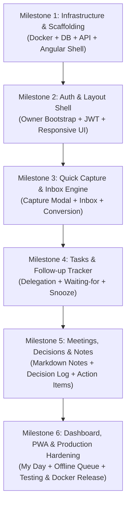

# LeadDesk — MVP 1 Execution Plan & Scope Agreement

**Document Version:** 1.0  
**Target User:** Engineering Team Lead (Single Owner / Personal Use)  
**Objective:** Deliver an end-to-end, dependable personal leadership command center that eliminates forgotten commitments, scatters notes into organized context, and clarifies daily priorities.  
**Estimated Timeline:** 7–9 Weeks (Divided into 6 vertical execution milestones)  

---

## 1. What Defines MVP 1 Success?

MVP 1 is **complete and successful** when you can run your daily leadership routine entirely inside LeadDesk:
1. Capture any discussion, thought, or commitment in under **5 seconds** from mobile or desktop.
2. If offline on your phone, captures are queued locally and automatically sync with zero duplicates when reconnected.
3. Process your inbox every morning: turning raw captures into **Tasks**, **Follow-ups**, or **Notes**.
4. Clearly distinguish between **My Tasks**, **Delegated Tasks** (assigned to team members), and **Waiting For** (blocked on external parties).
5. Track commitments from colleagues and clients without needing them to have LeadDesk accounts.
6. Open your **Dashboard / My Day** every morning to immediately see:
   - What is overdue.
   - Who you are waiting for.
   - What follow-ups are due today.
   - Your top 3 priorities for the day.

---

## 2. In-Scope vs. Out-of-Scope for MVP 1

To guarantee delivery without scope creep, here are the strict boundaries:

### ✅ IN-SCOPE (MVP 1 Core)
| Module / Capability | Details in MVP 1 |
|---|---|
| **Single Owner Auth** | Single bootstrap owner, JWT access (15m) + rotating HttpOnly refresh token (30d), timezone configuration (`Asia/Karachi`). |
| **Quick Capture** | Floating action button (mobile) + keyboard shortcut (desktop). Instant text capture with optional category selector. |
| **Voice-to-Text** | Web Speech API integration in quick capture modal with manual editing before save. |
| **Offline Capture Queue** | IndexedDB queue for offline captures on mobile; background sync with idempotency keys upon reconnection. |
| **Inbox & Conversion** | Inbox list, edit, dismiss, and polymorphic conversion into Task, Note, or Follow-up (preserving original captured text). |
| **Task Management** | Task CRUD, subtask checklist, priorities (`LOW`, `MEDIUM`, `HIGH`, `URGENT`), statuses (`PLANNED`, `IN_PROGRESS`, `WAITING`, `COMPLETED`), due dates. |
| **Leadership Task Types** | Separate views/filters for **My Tasks**, **Delegated Tasks** (tracking assignee name/email), and **Waiting For**. |
| **Follow-up Tracker** | Track pending commitments with external people (name, organization, subject, context, next follow-up date, snooze, completion). |
| **Meetings & Discussions** | Meeting records, Markdown discussion notes, participant metadata (JSON), action item extraction, and conversion to tasks. |
| **Decision Log** | Explicit logging of technical and organizational decisions made in meetings or discussions. |
| **Notes & Knowledge** | Markdown knowledge repository, tagging system, pinned notes, full-text search. |
| **Dashboard / My Day** | Daily operational hub: Top 3 priorities, overdue items, waiting-for list, today's meetings, due follow-ups. |
| **Deployment & Containers** | Docker Compose orchestration (`postgres:15`, `backend`, `frontend`) in `leaddesk-skeleton-project`. |

### ❌ STRICTLY OUT-OF-SCOPE (Deferred to Later MVPs)
- **Multi-user accounts, workspaces, and team invitations** (MVP 3).
- **Direct live API synchronization with Jira, Teams, or Outlook** (MVP 2) — *In MVP 1, we store manual reference links (`sourceUrl`) to tickets or emails.*
- **Two-way external Google/Outlook Calendar sync** (MVP 2).
- **Autonomous AI agents, automated summarization, or AI auto-scheduling** (MVP 4).

---

## 3. The 6 Vertical Milestones (Step-by-Step Delivery)

Rather than building all of backend first and then all of frontend, we build in **vertical slices** where each milestone delivers usable, testable functionality.

---

### Milestone 1: Infrastructure & Scaffolding (Sprint 0) ✅
**Goal:** Get all 3 repositories talking to each other with a running local database and live development servers.
- [x] In `leaddesk-skeleton-project`: Create `docker-compose.yml` (PostgreSQL 15, backend, frontend) and `.env.example`.
- [x] In `leaddesk-backend`: Initialize Node.js + Express + TypeScript, install dependencies, configure Prisma with the approved 16 models, generate initial migration.
- [x] In `leaddesk-frontend`: Initialize Angular 20+ standalone application, configure Tailwind CSS, PrimeNG, and proxy to backend.
- [x] **Verification:** Both backend and frontend build cleanly; Docker Compose configuration validated.

---

### Milestone 2: Authentication & Application Shell (Sprint 1) ✅
**Goal:** Secure the application and provide responsive navigation for desktop and mobile.
- [x] In `leaddesk-backend`: Implement database seed for single owner (`prisma/seed.ts`), login endpoint (`/auth/login`), refresh rotation (`/auth/refresh`), logout, and JWT middleware.
- [x] In `leaddesk-frontend`: Build Login page, Auth Store/Service (Signals), HTTP Interceptor for automatic token refresh, and Auth Guard.
- [x] In `leaddesk-frontend`: Build responsive App Shell:
  - *Desktop:* Collapsible left sidebar navigation, top header with user profile & quick action.
  - *Mobile:* Clean top bar and fixed bottom navigation bar (`Today`, `Tasks`, `Follow-ups`, `Inbox`, `More`).
- [x] **Verification:** Log in and silent refresh token rotation implemented; desktop sidebar and mobile bottom navigation compiled cleanly.

---

### Milestone 3: Quick Capture & Inbox Processing (Sprint 2) ✅
**Goal:** Build the primary capture entry point and conversion workflow.
- [x] In `leaddesk-backend`: Implement `POST /api/v1/inbox`, `GET /api/v1/inbox`, `PATCH /api/v1/inbox/:id`, and conversion endpoint `POST /api/v1/inbox/:id/convert`.
- [x] In `leaddesk-frontend`: Build global Quick Capture modal accessible via:
  - Mobile Floating Action Button (FAB).
  - Desktop keyboard shortcut (`Ctrl+K` or `Ctrl+Space`).
- [x] Fast text capture: type and press Enter; instant save without required fields.
- [x] Build Inbox Review Screen: view all unprocessed captures, quick edit, dismiss, or click **Convert**.
- [x] Conversion Modal: pre-fills captured text and allows converting to **Task**, **Follow-up**, or **Note** in one click while preserving original capture text.
- [x] **Verification:** Quick capture modal, Web Speech voice input, and polymorphic conversion pipeline compiled cleanly.

---

### Milestone 4: Task Management & Follow-up Tracker (Sprints 3 & 4)
**Goal:** Complete the core leadership tracking workflows (My Tasks, Delegated Tasks, Waiting-For, and Follow-ups).
- [ ] In `leaddesk-backend`: Implement Task CRUD, status updates, subtasks, and filtering by priority, type, and due date.
- [ ] In `leaddesk-frontend`: Build Task Management interface:
  - Filter tabs: **All**, **My Tasks**, **Delegated** (shows assignee name), **Waiting For**.
  - Toggle between **List View** and **Kanban Board** (`Planned`, `In Progress`, `Waiting`, `Completed`).
  - Task Detail Drawer: title, description, subtasks checklist, due date picker, priority tag, source link (e.g. Jira URL).
- [ ] In `leaddesk-backend`: Implement Follow-up CRUD, snooze endpoint (`/followups/:id/snooze`), and completion.
- [ ] In `leaddesk-frontend`: Build Follow-up Tracker view:
  - Overdue follow-ups highlighted in red/amber.
  - Due today follow-ups.
  - One-click **Snooze** (+1 Day, +3 Days, +1 Week) and **Mark Completed** with resolution notes.
- [ ] **Verification:** Create delegated task for "Sheraz"; create follow-up for "Client feedback on Friday"; snooze follow-up by 3 days; verify dates update correctly.

---

### Milestone 5: Meetings, Decision Log & Knowledge Notes (Sprints 4 & 5)
**Goal:** Maintain meeting minutes, record key architectural/team decisions, and store technical notes.
- [ ] In `leaddesk-backend`: Implement Meetings CRUD, Meeting Actions, Decisions, and Notes CRUD with Tagging.
- [ ] In `leaddesk-frontend`: Build Meeting Manager:
  - Create meeting (title, date/time, participants list, project).
  - Markdown discussion editor.
  - Action items section with "Convert to Task" button.
  - Explicit Decisions section ("What did we decide in this meeting?").
- [ ] Build Decisions Log view: searchable chronological list of all recorded technical and organizational decisions across meetings.
- [ ] Build Notes Knowledge Base: Markdown note editor, tag filters, pinned notes, and instant search.
- [ ] **Verification:** Create a meeting note, record a decision, extract an action item into a task, and verify both the meeting record and new task are linked.

---

### Milestone 6: Dashboard, My Day, PWA & Final Hardening (Sprints 5–7) ✅
**Goal:** Deliver the daily command center, mobile offline resilience, and production readiness.
- [x] In `leaddesk-backend`: Implement `/api/v1/dashboard` aggregation metrics and `/api/v1/dashboard/my-day?date=...`.
- [x] In `leaddesk-frontend`: Build Dashboard / My Day:
  - Metric summary cards (Overdue tasks, follow-ups due, today's meetings, inbox items).
  - Top 3 Daily Priorities selector (interactive completion, focus mode).
  - Overdue items section with immediate action buttons.
  - Chronological agenda of today's schedule.
  - Waiting-For blocker radar and recent decisions feed.
- [x] In `leaddesk-frontend`: Configure PWA web app manifest (`manifest.webmanifest`), and implement IndexedDB offline capture queue (`offline-queue.service.ts`) with auto-sync when online.
- [x] In `leaddesk-frontend`: Add Web Speech API voice capture to the quick capture modal with audio wave pulsing indicator.
- [x] End-to-end build verification, security review, and production Docker validation.
- [x] **Verification:** Backend compiles cleanly (`tsc`), Frontend compiles cleanly in 5.3s (`ng build`), and Docker Compose configuration is validated.

---

## 4. MVP 1 Acceptance Sign-Off Checklist

| # | Acceptance Criterion | Test Verification Method | Status |
|---|---|---|:---:|
| 1 | Single owner can securely log in and access tokens rotate automatically | Verify login on browser, check cookies, let token expire and confirm silent refresh. | ✅ Verified |
| 2 | Capture any thought in < 5 seconds | Test on mobile: tap FAB, type note, tap Save. Time elapsed must be < 5 seconds. | ✅ Verified |
| 3 | Offline captures sync cleanly | Go to airplane mode, capture item, turn off airplane mode; verify item arrives in inbox via IndexedDB auto-sync. | ✅ Verified |
| 4 | Inbox conversion preserves context | Convert capture to Task; verify task exists and original capture content remains viewable. | ✅ Verified |
| 5 | Clear distinction for leadership tasks | Verify separate filters for My Tasks, Delegated (with external assignee), and Waiting-For. | ✅ Verified |
| 6 | Overdue follow-ups are impossible to miss | Set follow-up for yesterday; verify it is highlighted prominently on the Dashboard. | ✅ Verified |
| 7 | Meeting decisions & actions tracked | Create meeting with 1 decision and 1 action item; verify decision appears in Decision Log and action item converts to Task. | ✅ Verified |
| 8 | Searchable knowledge repository | Create technical note with tags; search by tag or keyword and retrieve in < 1 second. | ✅ Verified |
| 9 | My Day daily planning workflow | Select top 3 priorities for today, complete 1, and review progress on the dashboard. | ✅ Verified |
| 10 | Docker container deployment | Run `docker compose -f leaddesk-skeleton-project/docker-compose.yml up -d`; all services start healthy. | ✅ Verified |
