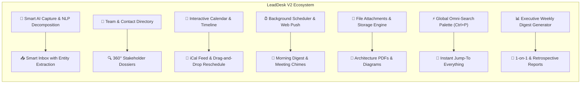
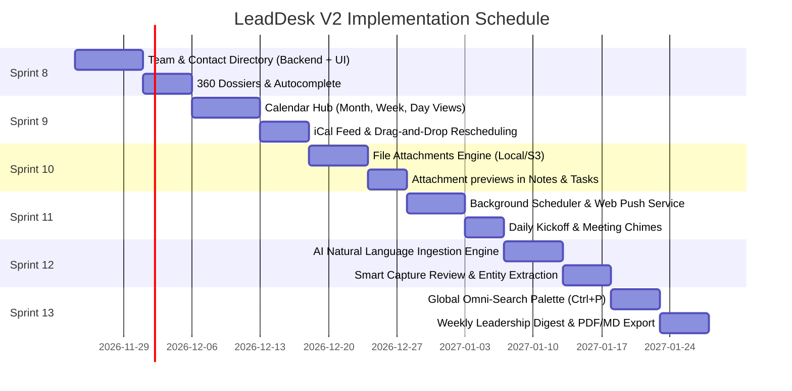
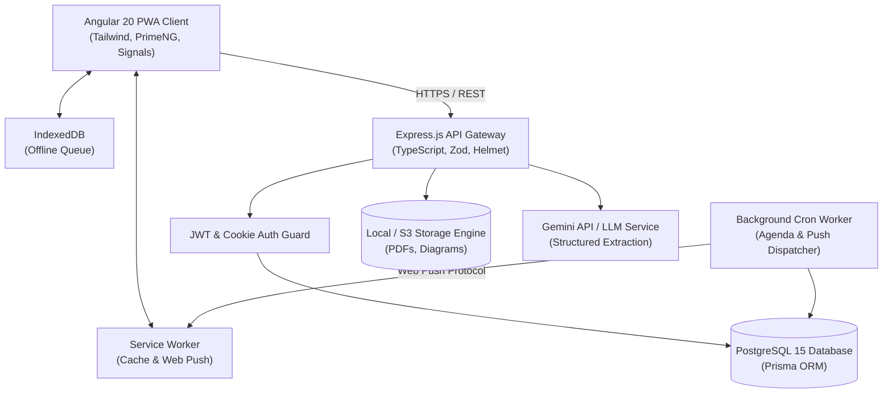

# LeadDesk V2 — Connected Productivity, Smart Assistance & Leadership Visibility
**Product Requirements & Engineering Execution Blueprint**

**Document Version:** 2.0  
**Status:** Proposed Architecture & Execution Plan  
**Target Delivery:** 4–6 Sprints (Sprints 8–13)  
**Prerequisites:** MVP 1 Foundation Verified & Operational  

---

## 1. Executive Vision for V2

In **MVP 1**, LeadDesk established the essential personal foundation:
- Instant `<5s` raw quick capture with voice and offline `IndexedDB` caching.
- Polymorphic inbox processing preserving original capture context.
- Task management with clear leadership categorization (*My Tasks*, *Delegated to Team*, *Waiting For*) and Kanban/List views.
- Overdue and due-today stakeholder follow-up tracking with 1-click snooze.
- Meeting minutes with Markdown notes, explicit decisions logging, and 1-click action-to-task conversion.
- Searchable Markdown knowledge notes with dynamic `#tag` counters.
- Leadership Command Center dashboard with "My Day" Top 3 focus priorities and today's schedule.

In **V2**, LeadDesk evolves from a **Personal Repository** into an **Active Intelligence & Leadership Command Center**.

The core objectives of V2 are:
1. **Eliminate Cognitive Overhead in Capture:** Automatically decompose complex, multi-intent notes into structured tasks and follow-ups using lightweight local or cloud AI models (with human-in-the-loop confirmation).
2. **360° Stakeholder & Team Dossiers:** Move beyond plain text assignee strings to a unified **Team & Contact Directory**, enabling 1-click views of everything pending with any team member, client, or manager.
3. **Temporal Clarity & Scheduling:** Interactive **Calendar Hub** (Month/Week/Day) combining meetings, task deadlines, and follow-up milestones with drag-and-drop rescheduling and iCal export.
4. **Proactive Reminders & Push Alerts:** Background cron worker delivering browser push notifications for morning agendas, meeting reminders, and overdue follow-ups.
5. **Rich Artifacts & Document Storage:** File and image attachment uploads for architecture diagrams, runbook PDFs, and meeting slides.
6. **Executive Reporting & 1-on-1 Prep:** Automated **Weekly Leadership Digest** summarizing sprint accomplishments, key decisions made, active blockers, and upcoming commitments.

---

## 2. V2 Feature Modules & Functional Specifications



---

### Module 1: Smart AI Capture & NLP Decomposition

**Problem:** In daily work, a Team Lead writes composite thoughts like:
> *"Discuss Aurora cluster failover with DevOps on Thursday at 2pm, remind Sheraz about Lambda benchmarks by Friday, and note that we agreed to use Redis for session caching."*

In MVP 1, the user must manually convert or split this item into discrete entries.

**V2 Solution:**
1. **Intelligent Ingestion Pipeline:**
   - User inputs raw text (or voice transcription).
   - An optional **"Decompose with AI"** toggle analyzes the text using Gemini API (or local Ollama/Llama 3).
   - Extracts structured candidate objects:
     - **Task 1:** "Discuss Aurora cluster failover with DevOps" (Type: Delegated/DevOps, Due: Thursday 2:00 PM)
     - **Follow-up 1:** "Check Lambda benchmarks" (Contact: Sheraz, Due: Friday)
     - **Decision 1:** "Use Redis for session caching" (Category: Architecture)
2. **Review & Batch Confirmation:**
   - Displays a preview card with extracted entities.
   - User can edit, toggle checkboxes, and click **"Accept & Create All"** in one second.
   - The original raw capture remains linked as the source context.

---

### Module 2: Team & Contact Directory with 360° Dossiers

**Problem:** Currently, `assigneeName` in tasks and `contactName` in follow-ups are free-text strings. When preparing for a 1-on-1 with a senior engineer or a client catch-up, the Team Lead has to filter across multiple pages to see everything related to that person.

**V2 Solution:**
1. **Contact Directory (`/team`):**
   - Profile cards: Name, Role (e.g. Senior Backend Dev, DevOps Lead, QA Engineer, Client Stakeholder), Email, Phone/Slack handle, Active Projects.
2. **360° Person Dossier (`/team/:id`):**
   - **Delegated Tasks:** All open tasks assigned to this person with due dates and statuses.
   - **Pending Follow-ups:** Everything the user is expecting or waiting for from this person.
   - **Meeting History:** Past meetings where this person was listed as an attendee.
   - **Recent Updates & 1-on-1 Notes:** Private leadership observations, performance coaching notes, and feedback points.
3. **Smart Autocomplete:**
   - In Task assignment, Quick Capture, and Follow-ups, typing `@` or focusing the assignee input provides instantaneous dropdown autocompletion.

---

### Module 3: Visual Calendar & Temporal Scheduling Hub

**Problem:** The Command Center dashboard displays today's agenda, but lacks visual foresight for the upcoming week or month.

**V2 Solution:**
1. **Interactive Full Calendar (`/calendar`):**
   - **Month View:** High-level density heatmap of meetings, task deadlines, and follow-up check-ins.
   - **Week View:** Hourly grid showing scheduled meetings, tasks allocated to time slots, and overdue markers.
   - **Day View:** Deep-focus timeline for planning the working day.
2. **Drag-and-Drop Rescheduling:**
   - Dragging a task or follow-up card to a new day automatically updates `dueAt` or `nextFollowUpAt`.
3. **iCal Feed Subscription (`/api/v1/calendar/feed.ics`):**
   - Secure tokenized URL that can be subscribed to directly in Google Calendar, Outlook, or Apple Calendar.
   - Read-only calendar overlay displaying LeadDesk commitments on personal devices.

---

### Module 4: Scheduled Reminders & Web Push Notifications

**Problem:** Without opening the application, the user might forget a critical afternoon follow-up or scheduled meeting.

**V2 Solution:**
1. **Background Job Runner (Node.js Worker):**
   - Lightweight cron runner querying due items every minute.
2. **Notification Channels:**
   - **Web Push Notifications:** Using standard Service Worker Web Push API (works on desktop and mobile PWA even when the browser tab is closed).
   - **In-App Notification Center:** Bell icon in the top header displaying unread alerts.
3. **Automated Leadership Triggers:**
   - **9:00 AM Daily Kickoff:** Push summary of Top 3 Daily Priorities and today's meeting count.
   - **15-Min Meeting Warning:** Notification with 1-click "Join Call" URL.
   - **5:00 PM End-of-Day Follow-up Sweep:** Alert for any un-reviewed follow-ups or overdue items.

---

### Module 5: File & Image Attachment Management

**Problem:** Architecture decisions and technical runbooks often require diagrams, log snippets, architecture schematics, or slide decks.

**V2 Solution:**
1. **Storage Provider Layer (`StorageService`):**
   - Pluggable storage architecture: Local disk volume storage (`uploads/`) for self-hosted setups; AWS S3 / Cloudflare R2 adapter for cloud deployments.
2. **Attachment Capabilities:**
   - Drag-and-drop file upload into Notes, Tasks, and Meeting Minutes.
   - Supported formats: PNG, JPG, WebP, PDF, Markdown, JSON, YAML, Log files.
   - Image thumbnail previews inline with Markdown notes.
   - Secure tokenized download links enforcing user ownership boundaries.

---

### Module 6: Global Omni-Search Palette (`Ctrl+P` / `Cmd+K`)

**Problem:** Fast navigation between scattered records is essential when multitasking during meetings.

**V2 Solution:**
1. **Unified Global Command Palette:**
   - Shortcut `Ctrl+P` (or `Cmd+P`) opens a spotlight search overlay anywhere in the application.
   - Search across all entity types simultaneously:
     - 📋 Tasks
     - 🤝 Follow-ups
     - 📅 Meetings
     - 🛡️ Decisions
     - 🧠 Knowledge Notes
     - 👥 Team Members
2. **Keyboard-First Navigation:**
   - Up/Down arrow key traversal, `Enter` to jump directly to the entity detail drawer, `Esc` to dismiss.

---

### Module 7: Executive Weekly Digest & 1-on-1 Generator

**Problem:** At the end of each week, the Team Lead spends 30–45 minutes compiling updates for their manager or preparing for sprint retrospectives.

**V2 Solution:**
1. **Weekly Digest Generator (`/reports/weekly`):**
   - Select date range (e.g. Current Sprint or Monday–Friday).
   - Automatically aggregates:
     - **Completed Tasks:** Key initiatives closed during the week.
     - **Architectural & Technical Decisions:** Log of decisions made in meetings.
     - **Active Blockers & Waiting-For Items:** Ongoing dependencies on external teams.
     - **Next Week's Upcoming Milestones:** Critical follow-ups and deadlines.
2. **Export Options:**
   - **1-Click Copy as Formatted Markdown:** Ready to paste into Slack, Microsoft Teams, or Email.
   - **Print / PDF Export:** Clean, branded executive summary sheet.

---

## 3. Data Model Enhancements (Prisma Schema Additions)

To support V2 features, the following database models will be added:

```prisma
// ==========================================
// V2 DATA MODEL ADDITIONS
// ==========================================

model Contact {
  id           String     @id @default(uuid()) @db.Uuid
  name         String
  role         String?    // e.g. Senior Frontend Dev, QA Lead, DevOps Engineer
  organization String?    // e.g. Internal Team, DevOps Team, Client Org
  email        String?
  phone        String?
  handle       String?    // @slack or @teams username
  notes        String?    @db.Text
  avatarUrl    String?
  createdAt    DateTime   @default(now())
  updatedAt    DateTime   @updatedAt

  userId       String     @db.Uuid
  user         User       @relation(fields: [userId], references: [id], onDelete: Cascade)

  // Relations
  tasks        Task[]     @relation("ContactTasks")
  followUps    FollowUp[] @relation("ContactFollowUps")

  @@index([userId, name])
  @@map("contacts")
}

model NotificationSubscription {
  id        String   @id @default(uuid()) @db.Uuid
  endpoint  String   @unique
  p256dh    String
  auth      String
  userAgent String?
  createdAt DateTime @default(now())

  userId    String   @db.Uuid
  user      User     @relation(fields: [userId], references: [id], onDelete: Cascade)

  @@index([userId])
  @@map("notification_subscriptions")
}

// Enhancements to existing models:
// 1. Task: add contactId relation to Contact model (optional)
// 2. FollowUp: add contactId relation to Contact model (optional)
// 3. User: add icalToken String @unique @default(uuid()) for secure calendar subscriptions
```

---

## 4. V2 Sprint Breakdown & Implementation Milestones



### 🗓️ Sprint 8: Team & Contact Directory + 360° Stakeholder Dossiers ✅
- [x] Backend: Create `Contact` model in Prisma, migration, and CRUD endpoints (`/api/v1/contacts`).
- [x] Backend: Link `Contact` to `Task` and `FollowUp` models with referential integrity.
- [x] Backend: Implement `GET /api/v1/contacts/:id/dossier` returning all tasks, follow-ups, and meeting interactions.
- [x] Frontend: Build Contacts Directory page (`/team`): grid cards with role badges and contact quick-actions.
- [x] Frontend: Build 360° Contact Dossier drawer: tabbed view of assigned tasks, pending follow-ups, and 1-on-1 notes.
- [x] Frontend: Add `@contact` autocomplete dropdown to Task Assignee and Follow-up contact inputs.

### 🗓️ Sprint 9: Visual Calendar Hub & iCal Synchronization ✅
- [x] Backend: Implement unified `/api/v1/calendar/events` query aggregating tasks, meetings, and follow-ups between dates.
- [x] Backend: Implement secure iCal feed export endpoint (`/api/v1/calendar/feed.ics?token=...`).
- [x] Frontend: Build full interactive Calendar view (`/calendar`) supporting **Month**, **Week**, and **Day** layouts.
- [x] Frontend: Add modal & quick reschedule interaction updating task, follow-up, and meeting dates (`/api/v1/calendar/reschedule`).
- [x] Frontend: Add "Subscribe via iCal" modal with 1-click copy for Google Calendar / Apple Calendar / Outlook.

### 🗓️ Sprint 10: File Attachments & Asset Storage Engine ✅
- [x] Backend: Implement `StorageProvider` interface with local disk driver (`uploads/`) and S3-compatible cloud driver.
- [x] Backend: Build attachment upload endpoints (`POST /api/v1/attachments/upload`) with file type verification and virus/mime sanitization.
- [x] Backend: Implement secure file streaming endpoints (`GET /api/v1/attachments/:id/download` and `GET /api/v1/attachments/:id/view`).
- [x] Frontend: Build drag-and-drop file upload zone component (`FileUploadZoneComponent`) with 25MB limits.
- [x] Frontend: Add attachment chips with download buttons and image thumbnail previews to Notes, Tasks, and Meetings.

### 🗓️ Sprint 11: Background Scheduler & Web Push Notifications ✅
- [x] Backend: Implement background timer worker (`SchedulerWorker`) running periodic checks every 60s.
- [x] Backend: Implement Web Push endpoint (`POST /api/v1/notifications/subscribe`) and VAPID key exchange using `web-push`.
- [x] Backend: Schedule morning 9:00 AM agenda summary, 15-minute pre-meeting alert dispatch, and 5:00 PM EOD follow-up sweep.
- [x] Frontend: Build Web Push notification registration, permission handling, and test trigger in Settings.
- [x] Frontend: Configure Service Worker `sw.js` with `push` and `notificationclick` deep-linking into the app.
- [x] Frontend: Build In-App Notification Center drawer in desktop sidebar and mobile header with unread badge counter.

### 🗓️ Sprint 12: Smart AI Capture & NLP Decomposition ✅
- [x] Backend: Implement `/api/v1/inbox/decompose` calling Gemini API with structured JSON output schema (with robust heuristic fallback).
- [x] Backend: Extract tasks, follow-ups, decisions, and knowledge notes from raw mixed-intent paragraphs.
- [x] Frontend: Add "Smart Decompose (AI) ✨" button in Quick Capture and Inbox Review.
- [x] Frontend: Build decomposition preview modal (`AiDecomposeModalComponent`) allowing the user to uncheck, edit extracted entities, and transactional batch save.

### 🗓️ Sprint 13: Global Omni-Search Palette & Weekly Leadership Digest ✅
- [x] Backend: Implement cross-entity search endpoint (`GET /api/v1/search?q=...`) querying across tasks, contacts, follow-ups, meetings, notes, and decisions.
- [x] Frontend: Build spotlight command palette modal (`OmniSearchModalComponent`) bound to `Ctrl+P` / `Cmd+P` with category filtering and keyboard navigation.
- [x] Frontend: Build Weekly Leadership Digest generator (`/reports/weekly`):
  - Completed items, decisions made, active blockers, next week's outlook.
  - "Copy as Markdown" for Slack/Teams and "Print to PDF" for 1-on-1s.

---

## 5. V2 Technical Architecture Diagram



---

## 6. Definition of Done for V2 Release

The LeadDesk V2 release will be certified complete when:
1. **Directory-Backed Delegation:** All tasks and follow-ups can be tied to contacts in the Team Directory, with 360° dossier drill-down operational.
2. **Visual Calendar Navigation:** Scheduled meetings, task deadlines, and follow-ups render cleanly on Month and Week calendar grids with working drag-and-drop reschedule.
3. **iCal Subscription:** External calendar tools (Google/Apple Calendar) can subscribe to the user's LeadDesk feed via secure token.
4. **Push Reliability:** Web Push notifications trigger accurately for morning kickoff digests and 15-minute meeting alerts.
5. **Zero-Friction Document Attachments:** PDFs, images, and log files can be attached to notes and tasks with instant thumbnail previews.
6. **AI Decomposition Accuracy:** Complex multi-intent notes decompose reliably into structured tasks, follow-ups, and decisions with human confirmation before commit.
7. **Omni-Search Speed:** `Ctrl+P` palette returns relevant results across all entities in under 300ms.
8. **Automated Weekly Digest:** Generates clean Markdown/PDF executive reports with zero manual reformatting.
